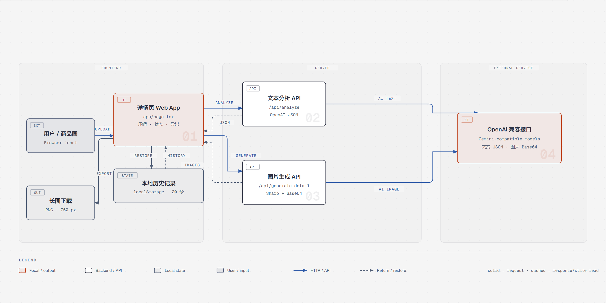

# AI 详情页生成器

基于 AI 的电商详情页生成工具，支持上传商品图片，自动分析并生成完整的营销详情页内容。

## 功能特性

- **图片上传** - 支持拖拽或点击上传商品图片
- **AI 分析** - 自动识别商品特征、材质、风格
- **详情页生成** - AI 生成标题、副标题、卖点、材质信息等完整营销内容
- **设计方向推荐** - 提供视觉风格、配色方案、排版建议
- **导出功能** - 支持将生成的详情页导出为图片

## 快速启动

```bash
# 安装依赖
npm install

# 启动开发服务器
npm run dev

# 打开 http://localhost:3000
```

## 环境配置

访客需在页面中填写自己的 API Key（默认使用 VectorEngine），无需为部署配置共享 Key。Key 只保留在当前页面内存中，刷新或点击“清除”后移除，不写入 localStorage、历史记录或服务端存储。

Key 经 HTTPS 请求头传到本站后端，再转发至固定的模型服务；不会放入网页源码、URL 或错误日志。Key 的持有人仍可通过自己浏览器的开发者工具查看自己的请求，这是正常行为。

如需修改模型服务地址或模型名称，可复制环境变量模板：

```bash
# 复制环境变量模板
cp .env.example .env
```

然后编辑 `.env` 文件（可选配置，不包含密钥）：

```env
# API 配置
API_BASE_URL=https://api.vectorengine.cn/v1

# 模型配置
GENERATE_API_MODEL=gemini-3-pro-image-preview
ANALYZE_API_MODEL=gemini-3.1-flash-lite-preview
```

### 环境变量说明

| 变量名 | 必填 | 说明 |
|--------|------|------|
| `API_BASE_URL` | 否 | 服务端固定 AI API 地址，默认 `https://api.vectorengine.cn/v1`；用户 Key 必须与此服务匹配 |
| `GENERATE_API_MODEL` | 否 | 生成详情页使用的模型，默认 `gemini-3-pro-image-preview` |
| `ANALYZE_API_MODEL` | 否 | 分析图片使用的模型，默认 `gemini-3.1-flash-lite-preview` |

## 注意事项

1. **API 密钥安全** - 请勿将 `.env` 文件提交到代码仓库（已通过 `.gitignore` 忽略）
2. **部署环境** - 不要配置共享 `API_KEY` 或任何 `NEXT_PUBLIC_*KEY`；API Key 只能由访客自行填写
3. **图片大小** - 上传图片会被压缩处理，建议单张不超过 5MB
4. **生成时间** - AI 分析和生成最长可能需要数分钟；每次请求使用当前访客的 Key，模型费用由访客承担

## 部署到 Vercel

1. 将本次代码提交并推送到 GitHub，在 [Vercel 新建项目](https://vercel.com/new) 中导入仓库，框架选择 Next.js，构建命令保留 `npm run build`，输出目录使用默认值。
2. 无需设置 API Key。只有更换模型服务时，才填写上述三个非密钥环境变量；服务地址只在后端配置，访客不能随意指定转发地址。
3. 点击 Deploy，成功后使用项目的正式域名 `项目名.vercel.app` 分享。
4. 在 Settings → Deployment Protection 中确认正式域名可匿名访问。Standard Protection 会保护预览和部署地址，同时允许正式域名公开访问；All Deployments 会保护正式域名。
5. 也可在本机登录后运行 `npx vercel@latest --prod` 发布；`.vercelignore` 已排除本地 `.env`、图片素材和测试文件。

Vercel 默认请求和普通响应有 4.5 MB 体积限制。本项目会在发送前限制请求为 4 MB，超大生成图片会压缩后返回；若提示图片总体积过大，请减少上传数量。两个接口最长运行时间均为 240 秒，应在项目设置中启用 Fluid Compute。

参考：[Vercel 函数限制](https://vercel.com/docs/functions/limitations)、[公开域名与部署保护](https://vercel.com/docs/deployment-protection)。

发布前验证：

```bash
npm test
npm run build
```

## 技术栈

- **框架**: Next.js 16
- **AI**: OpenAI API (支持 Gemini 等兼容模型)
- **图片处理**: Sharp
- **样式**: Tailwind CSS
- **图标**: Lucide React

## 系统架构

架构图展示浏览器端、Next.js API 路由与外部 AI 服务之间的请求链路，以及本地历史记录和长图导出路径。



[查看架构图源文件（HTML）](docs/architecture.html)

## 项目结构

```
app/
├── api/
│   ├── analyze/          # AI 图片分析接口
│   └── generate-detail/  # AI 详情页生成接口
├── page.tsx              # 主页面
└── layout.tsx            # 布局组件
.env                      # 环境变量（本地）
.env.example              # 环境变量模板
```

## 构建生产版本

```bash
npm run build
npm start
```

## 输入图


## 结果图


